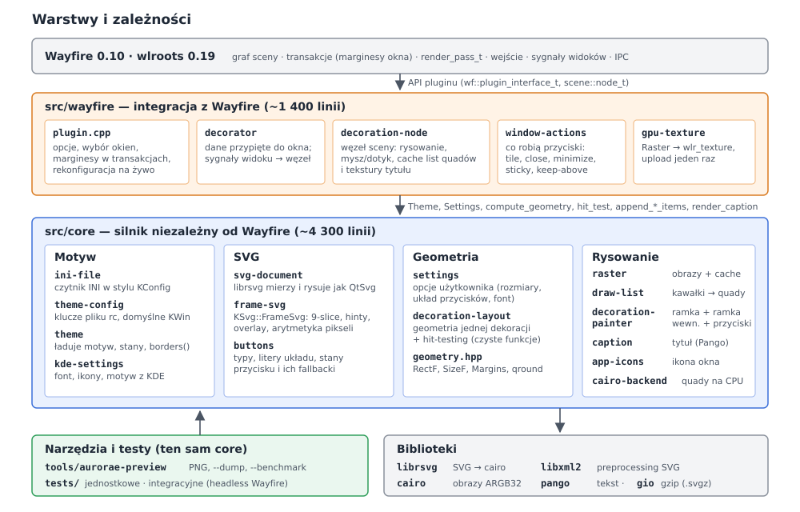
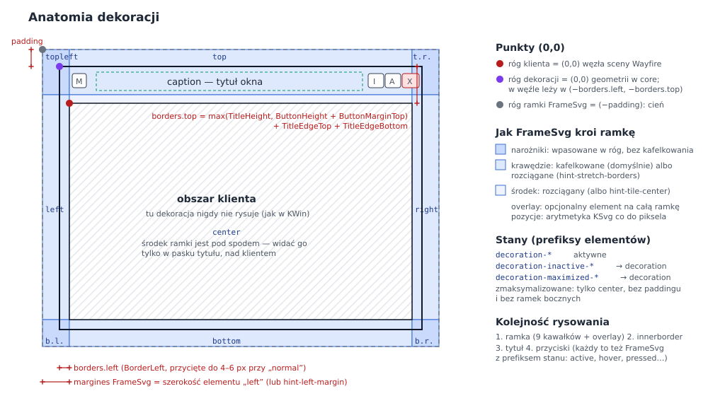
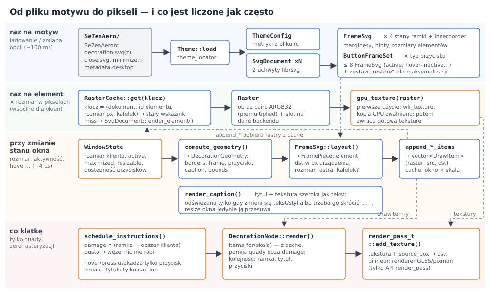
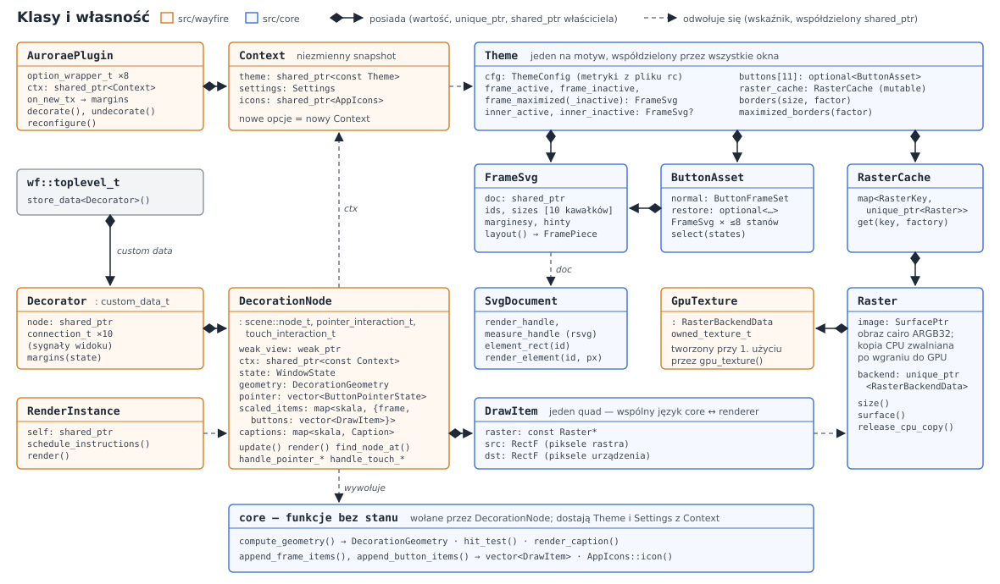
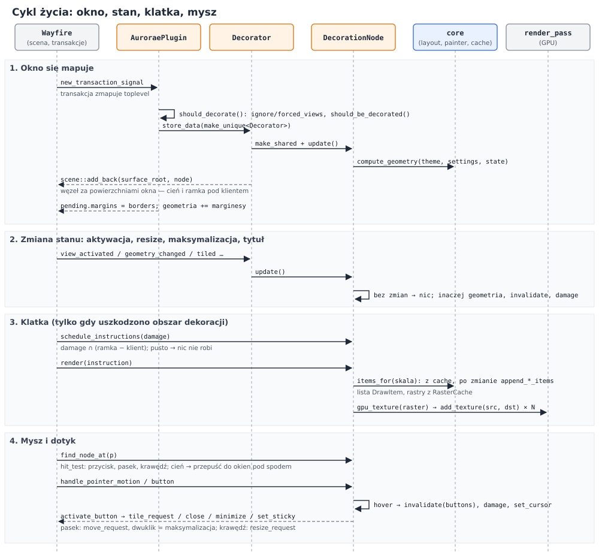
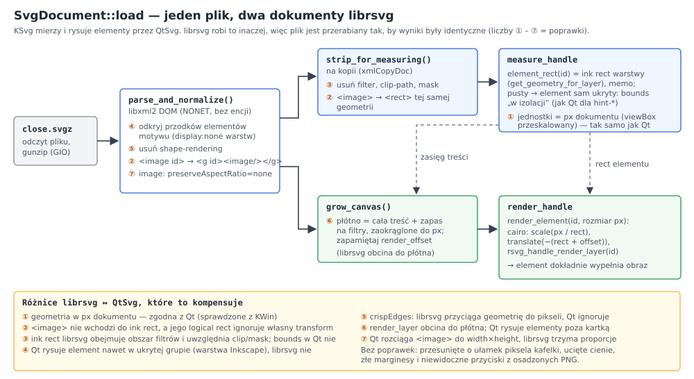
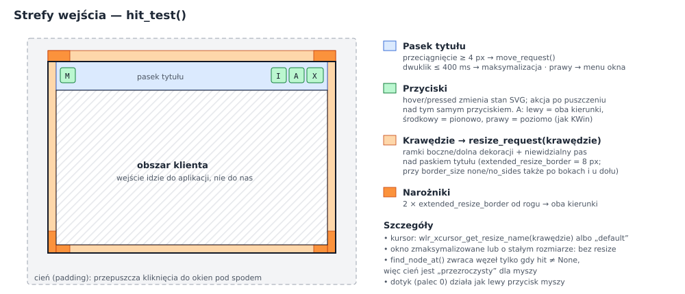

# Architektura wayfire-aurorae

Plugin rysuje ramki okien Wayfire z motywów KDE Aurorae (SVG) tak, żeby wyglądały
piksel w piksel jak w KWin, i nie spowalniał przy tym kompozytora. Ten dokument
tłumaczy, jak to działa pod spodem: z jakich warstw składa się kod, jak dane płyną
od pliku motywu do pikseli na ekranie, kto jest właścicielem jakich obiektów
i gdzie szukać, gdy chce się coś zmienić.

**W 30 sekund:**

- Kod ma dwie warstwy: **`src/core`** — cały „silnik” (motyw, SVG, geometria,
  rasteryzacja), bez żadnej zależności od Wayfire — oraz cienkie **`src/wayfire`**,
  które podpina silnik pod graf sceny, transakcje i wejście Wayfire.
- Motyw ładowany jest raz. Każdy element SVG (narożnik, krawędź, stan przycisku)
  jest rasteryzowany **raz na rozmiar w pikselach**, wgrywany do GPU i współdzielony
  przez wszystkie okna.
- Ramka okna to **lista kilkunastu teksturowanych prostokątów** (`DrawItem`).
  Liczy się ją tylko przy zmianie stanu okna; zmiana rozmiaru okna niczego nie
  rasteryzuje.
- Zgodność z KWin bierze się z wiernej reimplementacji `KSvg::FrameSvg`
  i silnika Aurorae „v2” oraz z preprocessingu SVG, który niweluje różnice
  librsvg ↔ QtSvg. Zgodność sprawdza się zrzutami z prawdziwego KWin.

---

## 1. Warstwy



Zależności idą tylko w dół: `src/wayfire` → `src/core` → biblioteki.
`src/core` nie widzi Wayfire, więc:

- narzędzie `aurorae-preview` i testy jednostkowe uruchamiają **dokładnie ten sam
  kod**, który działa w kompozytorze (tylko z innym „backendem” rysującym — cairo
  zamiast GPU),
- przeniesienie na inną wersję Wayfire (albo inny kompozytor) dotyczy tylko
  `src/wayfire` (~1 400 linii).

Jedynym punktem styku core ↔ renderer jest `DrawItem` (raster + prostokąt źródłowy
+ docelowy) oraz slot `Raster::backend_data()`, w którym backend trzyma swoją
kopię obrazu (u nas: teksturę `wlr_texture`).

## 2. Model motywu Aurorae — minimum, żeby czytać kod



Motyw to katalog `~/.local/share/aurorae/themes/<Nazwa>/`:

| Plik | Co zawiera |
|---|---|
| `<Nazwa>rc` | INI w stylu KConfig: `[General]` (kolory, wyrównanie tytułu, …) i `[Layout]` (ramki, krawędzie tytułu, rozmiary przycisków, `Padding*` = cień) |
| `decoration.svg(z)` | ramka: elementy `decoration-topleft`, `decoration-top`, … `decoration-center`, warianty `-inactive`, `-maximized`, `-maximized-inactive`, opcjonalnie `innerborder*` |
| `close.svg`, `minimize.svg`, … | przycisk = ramka z samym `center`, w stanach-prefiksach `active`, `hover`, `pressed`, `deactivated` i ich `-inactive` |
| `restore.svg` | przycisk maksymalizacji dla okna zmaksymalizowanego |

Kluczowe pojęcie to **FrameSvg** (z biblioteki KDE KSvg): ramka 9-slice opisana
elementami SVG o nazwach `<prefiks>-topleft` … `<prefiks>-center`. Rysuje się ją
w prostokącie dowolnego rozmiaru: narożniki wpasowane w rogi, krawędzie
kafelkowane (albo rozciągane przy `hint-stretch-borders`), środek rozciągany.
Marginesy ramki to rozmiary elementów (albo elementy `hint-*-margin`). Ważne
szczegóły, które kod odtwarza:

- **Prefiks bez elementu `center` „spada” na brak prefiksu** (KSvg tak robi) — dlatego
  `decoration-inactive` może nie istnieć, a motyw `glowglass` w ogóle nie ma
  prefiksów.
- Ramka dekoracji obejmuje okno **razem z cieniem** (`Padding*`). To, co wychodzi
  poza dekorację, jest cieniem; pod obszarem klienta nic nie rysujemy.
- Okno zmaksymalizowane używa tylko elementu `center` (bez ramek i cienia).
- `borders()` (grubość dekoracji) to **nie** to samo co marginesy FrameSvg:
  góra = wysokość tytułu + `TitleEdgeTop` + `TitleEdgeBottom`, boki są
  przycinane do zakresu z ustawienia KDE „rozmiar ramki” (dla `normal`: 4–6 px).

Kod używa dwóch układów współrzędnych (czerwona i fioletowa kropka na diagramie):
**współrzędne dekoracji** (0,0 = lewy górny róg dekoracji; cała geometria w core)
oraz **współrzędne węzła sceny** (0,0 = lewy górny róg klienta, tak jak w Wayfire).
Przejście to przesunięcie o `borders.left/top`
(`DecorationNode::to_decoration()` / `to_node_box()`).

## 3. Przepływ danych i cache



Cała wydajność wynika z tego, **na jakim poziomie co jest liczone**:

| Poziom | Co | Gdzie | Koszt |
|---|---|---|---|
| raz na motyw | parsowanie rc i SVG, `FrameSvg` dla każdego stanu, zestawy przycisków | `Theme::load()` | ~100 ms przy starcie / zmianie motywu |
| raz na element × rozmiar px | rasteryzacja elementu SVG → `Raster` → `wlr_texture` | `RasterCache::get()`, `gpu_texture()` | pierwsze okno: ~10–20 ms; potem 0 |
| zmiana stanu okna (per okno × skala wyjścia) | `compute_geometry()` + `append_*_items()` → `vector<DrawItem>` | `DecorationNode::update()` / `items_for()` | ~4 µs |
| zmiana tytułu | tekstura tytułu (Pango) | `render_caption()` | tylko gdy zmieni się tekst lub trzeba go skrócić |
| każda klatka | `add_texture()` dla quadów przecinających uszkodzony obszar | `DecorationNode::render()` | brak rasteryzacji |

Dwa triki, dzięki którym resize jest „darmowy”:

1. **KSvg i tak rozciąga bitmapy.** Element jest rysowany w naturalnym rozmiarze
   i skalowany jako obraz — więc zamiast renderować całą ramkę od nowa przy każdym
   rozmiarze (jak KWin), rasteryzujemy element raz i rozciągamy teksturę na GPU.
   Wynik jest ten sam.
2. **Tekstura tytułu ma szerokość tekstu**, a nie paska tytułu. Przy resize zmienia
   się tylko jej pozycja; nowy obraz powstaje dopiero, gdy tytuł trzeba skrócić „…”.

Kafelkowane krawędzie są wcześniej powielane w paski ≥ 512 px
(`RasterKind::TileStrip`), żeby długa krawędź to były 1–2 quady, a nie setki.

## 4. Klasy i własność



Zasady, które warto znać przed zmianami w kodzie:

- **`Context` jest niezmienny.** Plugin trzyma `shared_ptr<const Context>`
  (motyw + ustawienia + ikony). Każde okno dostaje kopię wskaźnika. Zmiana opcji =
  nowy `Context` i ponowne udekorowanie wszystkich okien (`reconfigure()`), więc
  nigdzie nie ma synchronizacji stanu ani „połowicznie” zmienionego motywu.
- **`Theme` jest współdzielony i tylko do odczytu** — poza `RasterCache`
  (`mutable`), który rośnie leniwie. Wskaźniki zwracane przez cache są stabilne
  przez cały czas życia motywu, dlatego `DrawItem` może trzymać gołe
  `const Raster*`.
- **Tekstury GPU żyją w rastrach** (`Raster::backend_data()` → `GpuTexture`).
  Po wgraniu kopia CPU jest zwalniana. Gdy znika ostatnie okno ze starym motywem,
  znika `Theme`, a z nim jego tekstury.
- **`Decorator`** to `wf::custom_data_t` przypięte do `wf::toplevel_t`: żyje dokładnie
  tyle, co okno lub do odebrania dekoracji. Trzyma węzeł sceny i połączenia
  sygnałów; w destruktorze wyjmuje węzeł ze sceny.
- **`DecorationNode`** jest `shared_ptr`, bo trzymają go też instancje renderowania
  Wayfire. Do widoku ma tylko `weak_ptr`, więc nigdy nie przedłuża życia okna.
  Uwaga: konstruktor nie może wołać `update()` (ten używa `shared_from_this()`) —
  robi to `Decorator` zaraz po `make_shared`.

## 5. Cykl życia



**Mapowanie okna.** Marginesy dekoracji muszą wejść do tej samej transakcji, która
mapuje okno — inaczej klient dostałby zły rozmiar. Dlatego plugin słucha
`txn::new_transaction_signal`, a nie `view_mapped`: przy pierwszej transakcji
decyduje (te same reguły co wbudowany `decoration`: `ignore_views`,
`forced_views`, `should_be_decorated()`), przypina `Decorator` i ustawia
`pending().margins`, powiększając geometrię tak, żeby **klient zachował rozmiar**.
Przy każdej kolejnej transakcji udekorowanego okna marginesy są przeliczane dla
stanu oczekującego (zmaksymalizowane okno ma inną górną ramkę i żadnych bocznych).

**Zmiana stanu.** Sygnały widoku (aktywacja, geometria, kafelkowanie, pełny ekran,
sticky, keep-above z `wm-actions`) wołają `DecorationNode::update()`, który składa
`WindowState` z bieżącego stanu okna i porównuje z poprzednim. Bez zmian → nic.
Inaczej: nowa `DecorationGeometry`, unieważnienie list quadów, `damage` starego
i nowego obszaru.

**Klatka.** `schedule_instructions()` przecina uszkodzony obszar z
`visible_region()` = ramka minus obszar klienta (jak w KWin: półprzezroczyste okno nie
pokazuje ramki pod spodem). Pusto → węzeł w ogóle nie rysuje. `render()` bierze
listy z cache dla skali wyjścia, pomija quady poza uszkodzeniem i dla reszty woła
`render_pass_t::add_texture()`. Bez surowego OpenGL, więc działa na rendererze GLES
i programowym (pixman).

## 6. Wczytywanie SVG: dlaczego dwa dokumenty



To najbardziej nieoczywista część kodu (`src/core/svg-document.cpp`). KSvg mierzy
elementy przez QtSvg, a od tych pomiarów zależą marginesy, rozmiary przycisków
i pozycje kafelków — błąd o ułamek piksela daje widoczne szwy. librsvg mierzy
inaczej, więc plik jest najpierw przerabiany w libxml2 na **dwa** dokumenty:

- **pomiarowy** — bez filtrów, clipów i masek, z obrazkami zastąpionymi
  prostokątami. Z niego bierzemy `element_rect()` (ink rect warstwy, z cache).
- **renderujący** — z płótnem powiększonym tak, żeby obejmowało całą treść
  (librsvg obcina rendering do płótna, a motywy trzymają np. overlay poza
  kartką). `render_element()` ustawia transformację cairo tak, że prostokąt
  elementu dokładnie wypełnia obraz, i woła `rsvg_handle_render_layer()`.

Każda z poprawek ①–⑦ została znaleziona przez porównanie z KWin na konkretnym
motywie. Komentarz na początku `svg-document.cpp` opisuje je szczegółowo — przy
zmianach tam zawsze uruchom porównanie z KWin (sekcja 10).

## 7. Wejście



`hit_test()` w `decoration-layout.cpp` jest czystą funkcją (geometria + punkt →
rodzaj strefy, indeks przycisku, krawędzie), więc da się go testować bez
kompozytora. `DecorationNode` tylko tłumaczy wynik na akcje: kursor, stan
hover/pressed, `move_request` / `resize_request` / akcje przycisków
(`window-actions.cpp`). `find_node_at()` zwraca węzeł tylko wtedy, gdy trafienie
jest różne od `None` — dzięki temu cień nie przechwytuje kliknięć.

## 8. Pliki źródłowe

### `src/core` — silnik

| Plik | Za co odpowiada | Kluczowe elementy |
|---|---|---|
| `geometry.hpp` | proste typy wartości | `RectF`, `SizeF`, `Size`, `Margins`, `Color`, `qround()` (zaokrąglanie jak Qt) |
| `ini-file.*` | czytnik INI w stylu KConfig: trim, komentarze `#`, ostatni duplikat wygrywa, escape'y, typowane gettery z fallbackiem | `IniFile`, `parse_int/bool/color` |
| `theme-config.*` | wszystkie klucze `<motyw>rc` z domyślnymi wartościami KWin i łańcuchami fallbacków (`ButtonWidthClose` → `ButtonWidth`) | `ThemeConfig::from_ini()` |
| `settings.*` | opcje użytkownika niezależne od motywu | `Settings`, `BorderSize`, `parse_border_size()`, `parse_button_size()` |
| `kde-settings.*` | odczyt `kdeglobals` / `kwinrc`, żeby domyślnie wyglądać jak Plasma | `titlebar_font()`, `icon_theme()`, `aurorae_theme()`, `qt_font_to_pango()` |
| `svg-document.*` | jeden plik SVG: preprocessing, pomiar elementów jak QtSvg, rasteryzacja elementu | `SvgDocument::load()`, `element_rect()`, `render_element()` |
| `frame-svg.*` | reimplementacja `KSvg::FrameSvg`: prefiksy, marginesy, hinty, overlay, arytmetyka pikseli 9-slice | `FrameSvg::layout()` → `FramePiece` |
| `buttons.*` | typy przycisków, litery układu KDE (`MS`/`HIAX`), stany przycisku i reguły fallbacku między nimi | `parse_button_layout()`, `ButtonFrameSet::select()` |
| `theme.*` | wyszukanie i załadowanie motywu, ramki dla stanów, przyciski, metryki KWin | `theme_locator`, `Theme::load()`, `borders()` |
| `decoration-layout.*` | geometria jednej dekoracji (ramka, cień, przyciski, tytuł) i hit-testing — czyste funkcje | `compute_geometry()`, `hit_test()` |
| `raster.*` | obraz CPU + slot backendu; cache z kluczem (dokument, element, rozmiar, kafelek) | `Raster`, `RasterCache`, `RasterKey` |
| `draw-list.*` | `FramePiece` → quady; paski kafelków; przycinanie | `append_frame()`, `clip_items()` |
| `decoration-painter.*` | składa ramkę, ramkę wewnętrzną i przyciski dla stanu okna | `append_frame_items()`, `append_button_items()`, `caption_style()` |
| `caption.*` | tytuł przez Pango: skracanie w środku, wyrównanie, linia bazowa jak w Qt, antyaliasing w skali szarości | `render_caption()`, `caption_text_width()` |
| `app-icons.*` | ikona okna dla przycisku menu bez SVG: `.desktop` → nazwa ikony → motyw ikon / hicolor / pixmaps | `AppIcons::icon()` |
| `cairo-backend.*` | rysowanie `DrawItem` na CPU (podgląd, testy) | `cairo_draw()` |

### `src/wayfire` — integracja

| Plik | Za co odpowiada |
|---|---|
| `plugin.cpp` | `AuroraePlugin`: opcje, wybór motywu (opcja → kwinrc → pierwszy znaleziony), które okna dekorować, marginesy w transakcjach, `reconfigure()` przy każdej zmianie opcji, ostrzeżenie gdy włączony jest też `decoration` |
| `decorator.*` | `Decorator`: przypięty do okna, tworzy węzeł, łączy sygnały widoku i wyjścia z `DecorationNode` |
| `decoration-node.*` | `DecorationNode` + instancja renderowania: stan okna, geometria, cache list quadów i tekstur tytułu per skala, rysowanie, mysz i dotyk |
| `window-actions.*` | dostępność przycisków (np. „wszystkie pulpity” tylko przy >1 obszarze roboczym) i ich akcje w Wayfire: `tile_request`, `close`, `minimize_request`, `set_sticky`, sygnał keep-above z `wm-actions`, sygnał menu okna |
| `gpu-texture.*` | `Raster` → `wf::owned_texture_t` przy pierwszym użyciu |

### Narzędzia i testy

| Ścieżka | Co robi |
|---|---|
| `tools/aurorae-preview.cpp` | renderuje atrapę okna do PNG tym samym core (`--sheet`, `--dump`, `--benchmark`, `--list`) |
| `tools/kwin-reference.sh` | zrzut tego samego okna z zagnieżdżonego KWin (izolowana konfiguracja) — wzorzec 1:1 |
| `tools/compare.py` | porównanie piksel w piksel dwóch zrzutów |
| `tests/test-*.cpp` | testy jednostkowe core (21): INI, konfiguracja, geometria SVG, layout FrameSvg, metryki, hit-testing |
| `tests/data/` | syntetyczne SVG i motyw `TestTheme` o znanych wymiarach |
| `tests/integration/run.py` | prawdziwy Wayfire headless + wirtualna mysz (`stipc`): przyciski, przeciąganie, resize, pełny ekran, zmiana opcji na żywo |

## 9. Wydajność w liczbach

Zmierzone na Intel GPU, motyw Se7enAero:

| Pomiar | Wynik |
|---|---|
| załadowanie motywu | ~100 ms (raz) |
| pierwsza dekoracja (rasteryzacja elementów) | ~15–20 ms (raz na rozmiar) |
| przeliczenie dekoracji po zmianie stanu | ~4 µs |
| 300 kroków interaktywnego resize'u, CPU procesu Wayfire | **0,61 s** z `aurorae` vs **1,10 s** z wbudowanym `decoration` |

Zasady, których warto pilnować przy zmianach: nic nie rasteryzować w `render()`;
`damage` tylko tego, co się zmieniło (hover → prostokąt przycisku, tytuł → caption);
nie unieważniać list quadów ramki, gdy zmieniają się tylko przyciski
(`invalidate(frame, buttons)`).

## 10. Zgodność z KWin

Punktem odniesienia jest **silnik SVG „v2” z KWin 6.6+**
(`library=org.kde.kwin.aurorae.v2`). Stary silnik QML (`org.kde.kwin.aurorae`)
rysuje inaczej. Świadomie odtworzone zachowania:

- przycinanie ramek do zakresów rozmiaru ramki KDE (opcja `border_size = theme` to wyłącza),
- tytuł: skracanie w środku, wyśrodkowanie na ascent + descent, linia bazowa
  zaokrąglana w dół jak w Qt,
- ramka wewnętrzna umieszczona tak jak w v2 (widać tylko jej górną i lewą krawędź —
  wygląda na błąd KWin, ale celem jest 1:1),
- brak animacji i cienia tekstu (v2 ich nie ma; cień tekstu jest opcją).

Jedyna zamierzona różnica: na ekranach HiDPI elementy są rasteryzowane w pełnej
rozdzielczości, więc są ostrzejsze niż w KWin (który powiększa obrazy 1×).
Geometria jest identyczna.

Jak sprawdzić zmianę:

```bash
tools/kwin-reference.sh ~/.local/share/aurorae/themes/Se7enAero kwin.png
build/aurorae-preview --theme Se7enAero --hide S --backdrop 255,255,255 --font "Noto Sans 10" -o ours.png
tools/compare.py kwin.png ours.png diff.png
```

Na czterech przykładowych motywach ramki i przyciski różnią się od KWin zerem
pikseli; różnice zostają tylko w tekście (Pango vs Qt, ±1 px) i ikonie aplikacji.

## 11. Gdzie zacząć przy typowych zmianach

| Chcę… | Zacznij od |
|---|---|
| przenieść na Wayfire 0.12 | tylko `src/wayfire`: w 0.12 geometria i regiony są zmiennoprzecinkowe (`wf::geometry_t` z `double`, `regionf_t`); core bez zmian |
| obsłużyć nowy hint KSvg | `FrameSvg` (konstruktor + `layout()`), test w `tests/test-frame.cpp` |
| zmienić akcję przycisku / dodać przycisk | `window-actions.cpp` (`button_availability()`, `activate_button()`) |
| dodać rozmycie pod ramką (`mask`) | `FrameSvg` z prefiksem `mask` → region w `DecorationNode`, integracja z pluginem `blur` |
| użyć silnika w innym kompozytorze | napisać odpowiednik `src/wayfire` (węzeł + backend `DrawItem` → tekstura); `src/core` zostaje |
| zbadać, czemu motyw wygląda źle | `aurorae-preview --theme X --dump` (rozmiary elementów, marginesy, kawałki), potem porównanie z KWin |

## 12. Testy

```bash
meson test -C build                                        # testy jednostkowe core
tests/integration/run.py                                   # headless Wayfire, renderer programowy
tests/integration/run.py --theme <katalog motywu> --gpu    # dowolny motyw, renderer GLES
```

Testy integracyjne liczą pozycje przycisków z `aurorae-preview --dump`, więc działają
z każdym motywem. Potrzebują `wayfire` z pluginami `ipc`, `ipc-rules`, `stipc`
oraz `foot`; zrzuty (`--keep`) wymagają `grim`.
