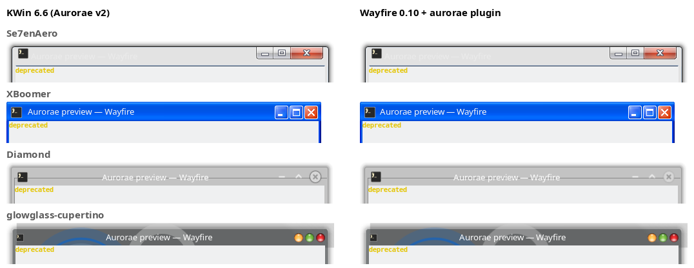

# wayfire-aurorae

A [Wayfire](https://wayfire.org) plugin that draws window decorations from KDE
**Aurorae** SVG themes — the same theme packages KWin uses, unchanged. Put a
theme in `~/.local/share/aurorae/themes/` (where Plasma's "Get New Window
Decorations" puts them) and Wayfire draws it like KWin does.



*Left: KWin 6.6 with its own Aurorae engine. Right: Wayfire 0.10 with this
plugin. Frames, buttons and layout are pixel-identical; title text may differ
by a pixel (Pango vs. Qt text rendering).*

## Features

- Aurorae SVG themes 1:1 with current KWin (the "v2" SVG engine of Plasma 6):
  nine-slice frames with all KSvg hints (`hint-*-margin`, `hint-stretch-borders`,
  `hint-tile-center`, `hint-no-border-padding`, overlays), active / inactive /
  maximized variants, inner borders, shadows from `Padding*`, every button
  state (`active`, `hover`, `pressed`, `deactivated` and their `-inactive`
  forms), restore button, button group hover, `.svgz`, embedded PNGs.
- KWin's metrics: border sizes (none … oversized), button sizes, button
  layout letters (`MS` / `HIAX`), title alignment, caption elision.
- Behaves like KWin: drag the title bar to move, double-click to maximize,
  maximize button with left / middle / right click (both / vertical /
  horizontal), resize from the borders and from an invisible area above the
  title bar, menu button shows the application icon.
- Fast: every SVG element is rasterized once per theme and output scale and
  shared by all windows as a GPU texture; a frame is a handful of textured
  quads. Resizing a window renders nothing. In a resize benchmark Wayfire used
  ~45 % less CPU than with its built-in `decoration` plugin
  (see [ARCHITECTURE.md](ARCHITECTURE.md), in Polish, with diagrams).
- Works with Wayfire's GLES and software (pixman) renderers, HiDPI and
  fractional scaling.
- With default options it follows your KDE settings if present: the KWin theme
  (`kwinrc`), title font (`kdeglobals`) and icon theme.

## Requirements

Wayfire 0.10 (the `wayfire` package of Ubuntu 26.04) and:

```bash
sudo apt install wayfire-dev librsvg2-dev libxml2-dev meson ninja-build g++
```

## Build, test, install

```bash
meson setup build
ninja -C build
meson test -C build
sudo ninja -C build install
```

This installs `libaurorae.so` into Wayfire's plugin directory,
`aurorae.xml` into its metadata directory and the `aurorae-preview` tool.

To try it without installing, point Wayfire at the build directory:

```bash
WAYFIRE_PLUGIN_PATH=$PWD/build WAYFIRE_PLUGIN_XML_PATH=$PWD/metadata wayfire
```

## Configuration

In `~/.config/wayfire.ini`, use `aurorae` *instead of* `decoration`, and ask
clients for server-side decorations:

```ini
[core]
plugins = ... aurorae ...
preferred_decoration_mode = server

[aurorae]
# Theme name (folder in ~/.local/share/aurorae/themes or /usr/share/aurorae/themes)
# or a path to a theme folder. Empty: the theme KWin uses, else the first found.
theme = Se7enAero
# none | no_sides | tiny | normal | large | very_large | huge | very_huge | oversized | theme
border_size = normal
# tiny | normal | large | very_large | huge | very_huge | oversized
button_size = normal
# KDE letters: M menu, S all workspaces, F keep above, I minimize, A maximize, X close, _ spacer
buttons_left = MS
buttons_right = HIAX
# Pango font; empty = KDE's title bar font, else Noto Sans 10
font =
# Draw the text shadow some old themes define (current KWin does not)
legacy_text_shadow = false
# Invisible resize area above the title bar, in pixels
extended_resize_border = 8
ignore_views = none
forced_views = none
```

All options apply live, without restarting Wayfire.

`border_size = normal` is KWin's default and clamps theme borders to 4–6 px,
exactly as KWin does; `theme` uses the theme's own values.

## Tools

- `aurorae-preview` renders a decorated mock window with the plugin's code —
  check a theme without restarting the compositor:
  ```bash
  aurorae-preview --theme Se7enAero --sheet -o sheet.png   # active, inactive, hover, pressed, maximized
  aurorae-preview --list                                   # installed themes
  aurorae-preview --theme Se7enAero --dump                 # element sizes, margins, layout
  aurorae-preview --theme Se7enAero --benchmark
  ```
- `tools/kwin-reference.sh THEME_DIR out.png` takes the same window drawn by
  KWin itself (nested, with throw-away settings), and `tools/compare.py`
  diffs the two. This is how the 1:1 claim is checked.
- `tests/integration/run.py [--theme DIR] [--gpu]` runs the plugin in a
  headless Wayfire and clicks through buttons, drags, resizes, fullscreen and
  live reconfiguration with a virtual pointer.

## Differences from KWin

What Wayfire has no equivalent for is hidden: shade, keep-below, context
help and application-menu buttons. The menu button opens Wayfire's window
menu request (shown if a plugin or shell implements one). "On all desktops"
toggles Wayfire's sticky state and is shown when there is more than one
workspace, keep-above uses the `wm-actions` plugin.

Not implemented yet: blur behind translucent decorations (the theme's `mask`
element), decorations on sides other than the top (KWin's own SVG engine
does not lay those out correctly either). Like current KWin there are no
state animations.

On HiDPI outputs elements are rasterized at device resolution, so they are
sharper than KWin's (which upscales 1× images); geometry is identical.

## License

Not chosen yet. The rendering rules follow KWin's Aurorae (GPL-2.0-or-later)
and KSvg (LGPL-2.0-or-later), reimplemented without copying their code;
GPL-2.0-or-later would be the natural choice.
